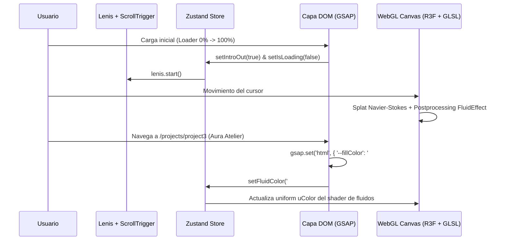

# KAIRO — Arquitectura Técnica Detallada

Esta guía documenta la ingeniería detrás de **KAIRO** (`kairo.studio`): cómo conviven **Next.js 14**, **React Three Fiber / Three.js**, **shaders GLSL personalizados**, **simulación de fluidos Navier-Stokes**, **física Rapier 3D**, **GSAP + Lenis** y el sistema dinámico de tokens **Dark Luxury**.

---

## 1. Arquitectura Dual: DOM Editorial + Canvas WebGL

En lugar de encerrar el 3D dentro de cajas aisladas, KAIRO separa la interfaz en **dos planos persistentes**:

1. **Capa DOM (`<main>`)**: Contiene la tipografía editorial, grillas responsivas, tarjetas de casos de estudio, navegación y SEO/JSON-LD.
2. **Capa WebGL (`<Canvas>`)**: Un viewport WebGL fijo detrás/sobre el contenido que se mantiene montado entre transiciones de página para evitar recargas de contexto GPU.

Ambos planos se comunican a través de un **Store ligero en Zustand** (`lenis`, `isLoading`, `introOut`, `isMenuOpen`, `fluidColor`) sin provocar re-renders innecesarios en el árbol de React.

---

## 2. Pipeline WebGL &amp; Shaders GLSL

### A. Shader de Fondo Procedural (Perlin Noise)
- Un plano *fullscreen* renderiza ruido Perlin animado por tiempo (`uTime`) y resolución (`uResolution`).
- Genera variaciones sutiles de luminosidad sobre el fondo obsidiana (`#0B0C10`), eliminando la rigidez de los fondos planos sin el coste de ancho de banda de un video de fondo.

### B. Simulación de Fluidos Navier-Stokes en GPU
El efecto de fluido interactivo ejecuta un solver de fluidos incompresibles en tiempo real mediante múltiples pasadas de Fragment Shaders y buffers FBO (*ping-pong*):

1. **Splat Pass**: Convierte la velocidad y dirección del puntero en impulsos de fuerza y tinte (`fluidColor`).
2. **Curl &amp; Vorticity**: Añade turbulencia orgánica para evitar trayectorias artificialmente lineales.
3. **Divergence &amp; Pressure (Jacobi)**: Resuelve la ecuación de Poisson en múltiples iteraciones para garantizar conservación de masa.
4. **Gradient Subtract**: Proyecta el campo de velocidad a un estado libre de divergencia.
5. **Advection**: Transporta velocidad y densidad a través del campo con disipación controlada.
6. **Postprocessing Composite**: Mezcla el resultado final con la escena principal mediante un efecto personalizado en `@react-three/postprocessing`.

### C. Física 3D con Rapier (`@react-three/rapier`)
- Ejecuta colisiones y cuerpos rígidos compilados en **WebAssembly (WASM)**, manteniendo el renderizado a 60fps constantes incluso durante transiciones de scroll intensivas.

---

## 3. Coreografía de Movimiento (GSAP + Lenis + SplitType)

| Sistema | Responsabilidad |
| :--- | :--- |
| **Lenis** | Scroll suave basado en inercia física con sincronización en el bucle `RAF` de `Tempus`. |
| **GSAP + ScrollTrigger** | Scrubbed timelines para el apilamiento de proyectos, parallax de retratos, revelado del Footer (`yPercent: -50 → 0`) y transición del menú lateral. |
| **SplitType** | Divide titulares y párrafos en líneas animables para revelados editoriales precisos en `Loader` y `AppearTitle`. |
| **Contextos GSAP** | Cada componente envuelve sus animaciones en `gsap.context()` dentro de `useIsomorphicLayoutEffect`, limpiando triggers automáticamente al cambiar de ruta. |

---

## 4. Sistema de Tokens Dark Luxury

La identidad visual se gobierna mediante variables CSS en `:root` / `html`:

| Token | Valor Base | Uso |
| :--- | :--- | :--- |
| `--white` | `#0B0C10` | Superficie principal obsidiana |
| `--black` | `#F2EFE9` | Tipografía principal alabastro |
| `--muted` | `#9A968E` | Metadatos y subtítulos |
| `--accentColor` | `#161822` | Superficies elevadas y tarjetas |
| `--fillColor` | `#E5C17B` | Acento oro cepillado |
| `--menuColor` | `#FF5722` | Acento bermellón interactivo |
| `--menuFontColor` | `#0B0C10` | Contraste sobre acento bermellón |

Cada uno de los 5 casos de estudio redefine dinámicamente estas variables y el `fluidColor` al entrar a su ruta, y restaura la paleta base de **KAIRO** al salir.

---

## 5. Carpeta Pública de Visuales (`kairo/`)

La carpeta [`./kairo/`](./kairo/) agrupa los assets visuales HD optimizados en WebP y SVG:

- `logo.svg` — Wordmark vectorial de **KAIRO**.
- `og.png` — Tarjeta OpenGraph para redes sociales.
- `kairo-preview.gif` — Showcase animado de la experiencia en vivo.
- `portrait.webp` y `hero-studio.webp` — Fotografía editorial y de estudio.
- `aura-atelier.webp`, `synthos-os.webp`, `monolith-cad.webp`, `veloura-labs.webp`, `pulsar-engine.webp` — Visuales principales de los 5 casos de estudio.

---

> 🔒 ¿Quieres acceder al repositorio privado con el código fuente completo? Consulta **[`CONTRIBUTING.md`](./CONTRIBUTING.md)**.
