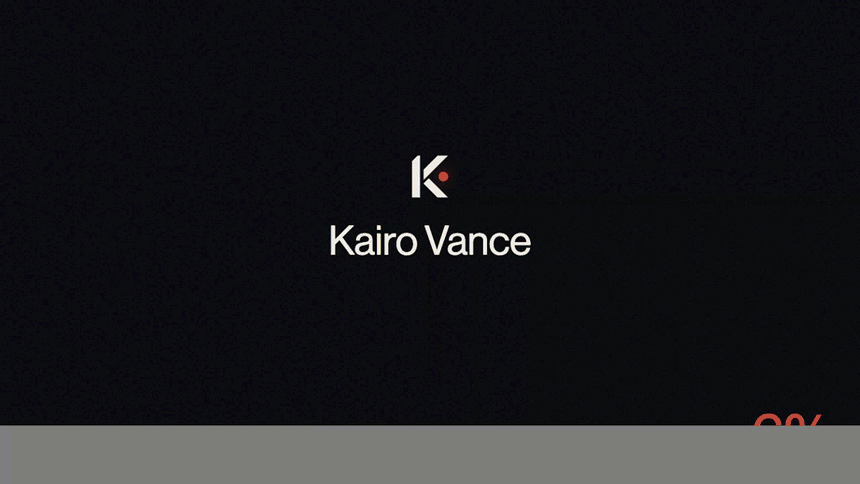
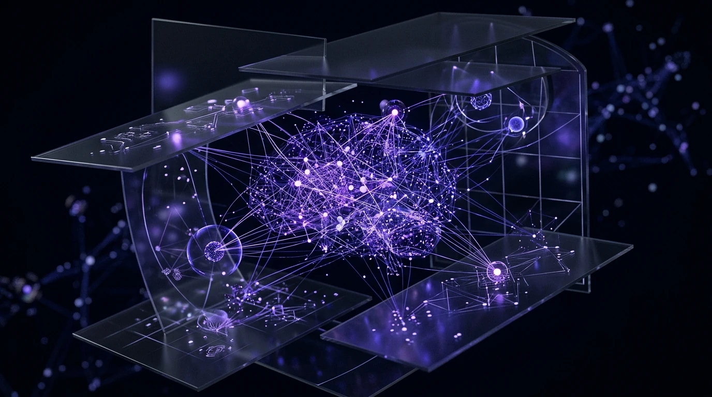
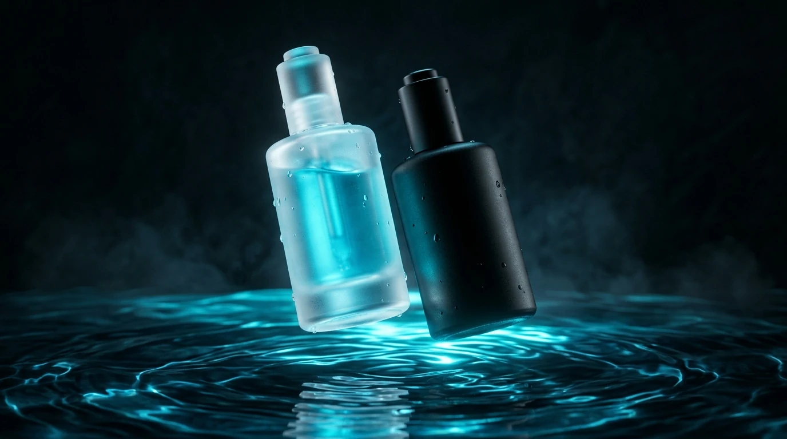
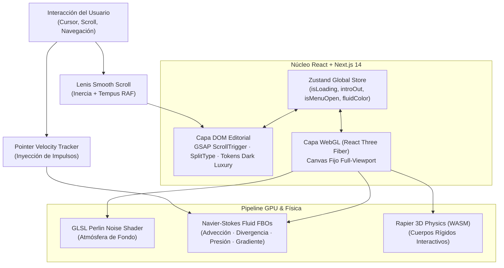

  
  <h1>KAIRO — Spatial Web &amp; 3D Interactive Experience</h1>
  

    <strong>Creative Technologist &amp; Spatial Web Engineer — Sculpting kinetic interfaces and spatial web experiences.</strong>
  

  

    
    
    
    
    
    
  

  

    <a href="#-galería-visual--carpeta-kairo">Galería Visual</a> ·
    <a href="#-cómo-funciona-la-arquitectura">Arquitectura Técnica</a> ·
    <a href="./ARCHITECTURE.md">Deep-Dive Técnico</a> ·
    <a href="#-acceso-al-repositorio-privado-descarga-del-código-fuente">Acceso al Código Privado</a>
  

---

---

## ✨ ¿Qué es KAIRO?

**KAIRO** (`kairo.studio`) es una experiencia web espacial de nivel **Awwwards** diseñada con estética **Dark Luxury** (`#0B0C10` obsidiana, `#F2EFE9` alabastro, `#E5C17B` oro cepillado y `#FF5722` bermellón cinético).

Combina renderizado **WebGL / Three.js en tiempo real**, simulación física de fluidos **Navier-Stokes** reactiva al cursor, shaders **GLSL Perlin**, física 3D con **Rapier**, coreografía de scroll con **GSAP + Lenis** y un sistema de tokens CSS dinámicos que transforma toda la atmósfera cromática de la web en cada caso de estudio.

> 📌 **Nota importante:** Este repositorio público ([`annoris/kairo`](https://github.com/annoris/kairo)) contiene la **documentación arquitectónica completa**, el **GIF showcase** y la **carpeta pública [`kairo/`](./kairo/)** con todos los visuales HD. El código fuente completo descargable vive en el **repositorio privado [`annoris/kairo-pro`](https://github.com/annoris/kairo-pro)** (acceso exclusivo para contribuidores; consulta la sección de [Acceso al Repositorio Privado](#-acceso-al-repositorio-privado-descarga-del-código-fuente)).

---

## 🎨 Galería Visual — Carpeta `kairo/`

Todos los visuales de alta definición están abiertos y disponibles dentro de [`./kairo/`](./kairo/) para que puedas explorar la dirección de arte y el sistema visual completo de la experiencia:

### Identidad &amp; Estudio

| Retrato Editorial (`kairo/portrait.webp`) | Estudio Panorámico (`kairo/hero-studio.webp`) |
| :---: | :---: |
|  |  |

### Casos de Estudio (5 Proyectos Interactivos)

| Proyecto | Disciplina &amp; Paleta | Preview HD |
| :--- | :--- | :---: |
| **AURA ATELIER** | Spatial 3D Flagship &amp; WebGL Interior Showroom `#0B0C10` · `#E5C17B` · `#FF5722` |  |
| **SYNTHOS OS** | Spatial AI Analytics &amp; Real-Time Control Engine `#0E1017` · `#C4B5FD` · `#6366F1` |  |
| **MONOLITH CAD** | Interactive 3D Architectural Modeling Platform `#110E14` · `#FDE68A` · `#D97706` |  |
| **VELOURA LABS** | Biotech Luxury Skincare Interactive Commerce `#0A1112` · `#67E8F9` · `#06B6D4` |  |
| **PULSAR ENGINE** | Real-Time Market Telemetry &amp; Data Visualization `#120E0D` · `#FDA4AF` · `#E11D48` |  |

---

## 🧠 Cómo Funciona la Arquitectura

KAIRO ejecuta dos capas sincronizadas a **60fps** — una capa **DOM editorial** y un **Canvas WebGL persistente** — orquestadas por **Zustand**, **Lenis** y **GSAP ScrollTrigger**:

### Pilares Técnicos

1. **Shaders GLSL &amp; Fondo Perlin**: Plano WebGL a pantalla completa impulsado por ruido Perlin procedural en fragment shaders personalizados, aportando profundidad orgánica sin cargar videos pesados.
2. **Simulación de Fluidos Navier-Stokes**: Pipeline multi-pasada en GPU con Frame Buffer Objects (FBOs) *ping-pong* (advección de velocidad, divergencia, iteración de presión Jacobi, resta de gradiente y *splats* del cursor) integrado como efecto de postprocesado en `@react-three/postprocessing`.
3. **Física 3D con Rapier (`@react-three/rapier`)**: Motor de física WebAssembly que simula gravedad, colisiones e impulsos en tiempo real sin bloquear el hilo principal de JavaScript.
4. **Animaciones GSAP + ScrollTrigger + SplitType**: Revelado cinético línea por línea (`AppearTitle`), transición de pantalla completa en el `Loader` (`0% → 100%`), menú lateral con escala 3D (`scale: 0.9` y borde `#FF5722`) y tarjetas de proyectos apiladas sincronizadas al scroll.
5. **Lenis Smooth Scroll**: Inercia mantecosa unificada con `ScrollTrigger` sobre un contenedor `main` dedicado y bucle `requestAnimationFrame` centralizado con `@darkroom.engineering/tempus`.
6. **Sistema de Tokens Dark Luxury Dinámico**: Variables CSS globales (`--white`, `--black`, `--accentColor`, `--fillColor`, `--menuColor`, `--menuFontColor`) que mutan en vivo al abrir cada proyecto junto con el color del fluido WebGL (`setFluidColor`).

> 📖 Lee el desglose técnico completo en **[`ARCHITECTURE.md`](./ARCHITECTURE.md)**.

---

## 🔒 Acceso al Repositorio Privado (Descarga del Código Fuente)

Este repositorio público (**[`annoris/kairo`](https://github.com/annoris/kairo)**) existe para compartir **la arquitectura completa, el GIF showcase, los estándares de diseño y la carpeta visual [`kairo/`](./kairo/)** con toda la comunidad.

El **código fuente completo y descargable** (componentes Next.js 14, shaders GLSL, simulación Navier-Stokes, escenas R3F/Rapier y configuración lista para producción) se mantiene en el **repositorio privado exclusivo [`annoris/kairo-pro`](https://github.com/annoris/kairo-pro)**.

### ¿Cómo desbloquear la invitación a `annoris/kairo-pro`?

**Solo quienes contribuyan activamente al proyecto reciben acceso al repositorio privado [`annoris/kairo-pro`](https://github.com/annoris/kairo-pro).** Puedes calificar mediante cualquiera de estas contribuciones:

- 🛠️ **Pull Request de valor** en [`annoris/kairo`](https://github.com/annoris/kairo) (mejoras a la documentación técnica, diagramas, guías de shaders, traducciones o casos de estudio).
- 🎨 **Aportes de diseño / feedback técnico profundo** abriendo un Issue detallado en [`annoris/kairo`](https://github.com/annoris/kairo/issues) con propuestas de UX, optimización WebGL o accesibilidad.
- 🤝 **Colaboración técnica o patrocinio** para impulsar el desarrollo de la plataforma.

👉 Revisa las instrucciones paso a paso en **[`CONTRIBUTING.md`](./CONTRIBUTING.md)** para enviar tu contribución y recibir tu invitación a **`annoris/kairo-pro`**.

---

  
Si este showcase y su arquitectura te inspiraron, dale una ⭐ al repositorio.

  KAIRO · Zurich, Switzerland · <a href="mailto:hello@kairo.studio">hello@kairo.studio</a>

