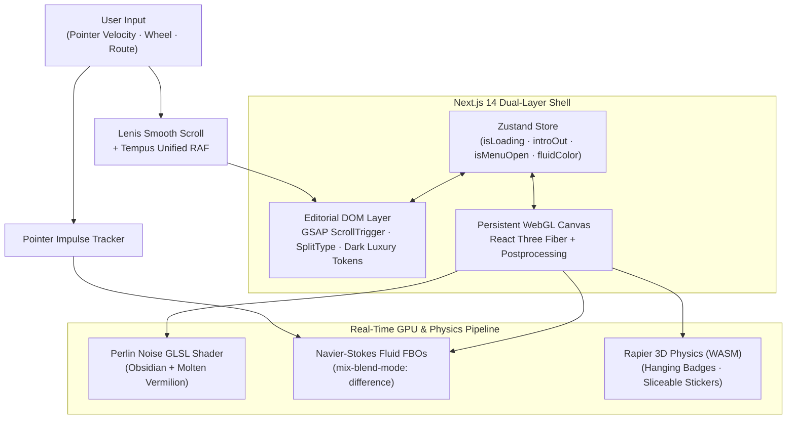
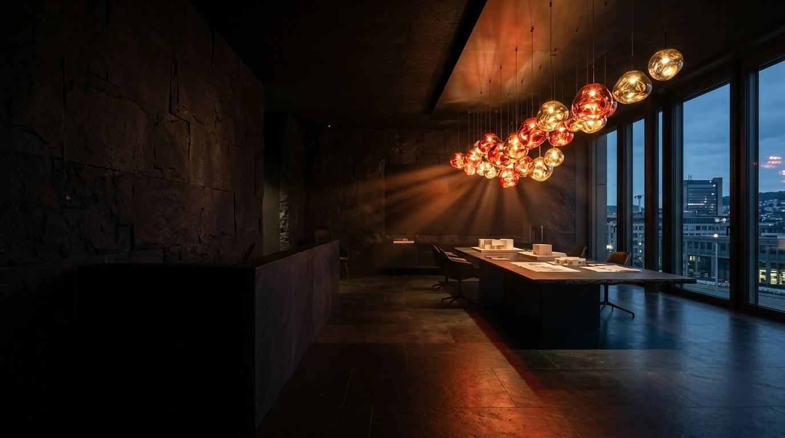
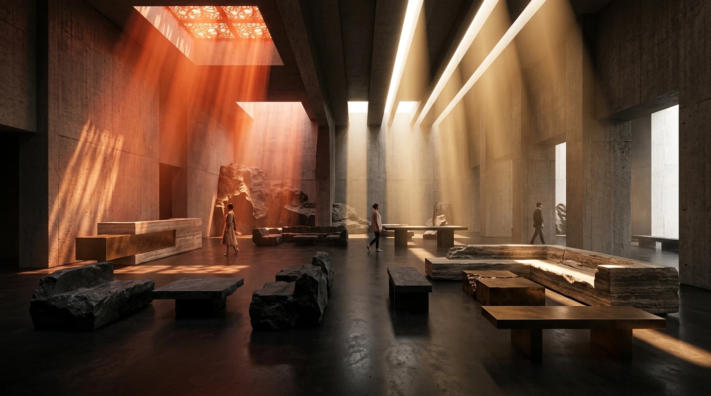
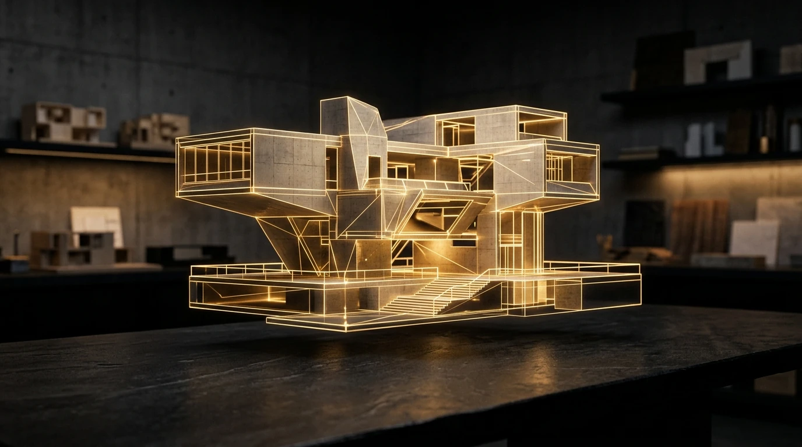
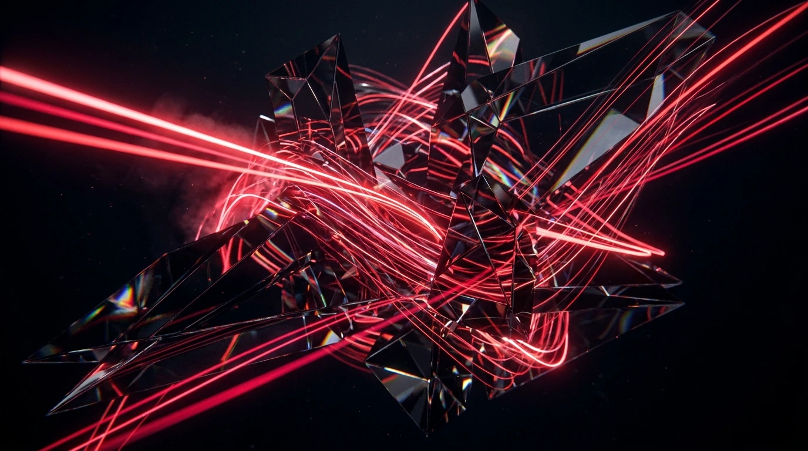

<div align="center">
  
  <h1>KAIRO — Spatial Web &amp; 3D Interactive Engine</h1>
  <p><strong>Real-Time Navier-Stokes Fluid Simulation + Raymarched GLSL Shaders + Rapier 3D Physics + GSAP Choreography in Next.js 14 — Built for 60 FPS Awwwards-Level Spatial Web.</strong></p>
  <p><sub><em>Experiencia Web Espacial 3D · Estética Dark Luxury · Arquitectura dual DOM + WebGL</em></sub></p>
  <p>
    <a href="https://annoris.github.io/kairo/"></a>
    <a href="https://github.com/annoris/kairo/stargazers"></a>
    
    
  </p>
  <p>
    <a href="https://annoris.github.io/kairo/"><strong>🚀 Live Demo</strong></a> ·
    <a href="#-whats-inside-the-engine-curiosity-teasers">Engine Teasers</a> ·
    <a href="#-performance--architecture-scorecard">Benchmarks</a> ·
    <a href="#-explore-the-public-kairo-visual-vault">Visual Vault</a> ·
    <a href="./ARCHITECTURE.md">Architecture</a> ·
    <a href="#-unlock-annoriskairo-pro-full-downloadable-source-code">Unlock <code>kairo-pro</code></a>
  </p>
</div>

<div align="center">
  <a href="https://annoris.github.io/kairo/">
    
  </a>
  <br />
  <h3>⭐ Star this repo if you love WebGL, GLSL Shaders &amp; Creative Engineering!</h3>
  <sub><em>Si te apasiona el Creative Coding, Three.js y el diseño Dark Luxury, deja tu ⭐ arriba — impulsa el proyecto y ayuda a que más devs lo descubran.</em></sub>
</div>

---

## 🔥 What's Inside the Engine (Curiosity Teasers)

Click any module below to peek under the hood of **KAIRO**'s dual **DOM + WebGL** engine — real production techniques distilled without spoilers:

<details>
<summary><strong>🌊 1. Real-Time Navier-Stokes Fluid Overlay (GPU Ping-Pong FBOs + <code>mix-blend-mode: difference</code>)</strong></summary>

<br />

Instead of a heavy canvas masking layer, KAIRO solves incompressible Navier-Stokes equations directly on the GPU (Splat → Curl → Vorticity → Divergence → Jacobi Pressure → Gradient Subtract → Advection) and composites the velocity field over editorial typography using `mix-blend-mode: difference`:

```glsl
// Simplified vorticity confinement & dye advection pass
vec2 coord = vUv - uTexelSize * velocity.xy * dt;
vec4 advected = texture2D(uSource, coord);
gl_FragColor = advected / (1.0 + uDissipation * dt);
```

Because the fluid overlay blends optically with the `#0B0C10` obsidian canvas and `#F2EFE9` alabaster headlines, moving your cursor carves inverted chromatic ripples across text at a locked **60 FPS**.

</details>

<details>
<summary><strong>🌋 2. Procedural Perlin Noise GLSL Shader &amp; Molten Vermilion (<code>#FF5722</code>) Ridges</strong></summary>

<br />

The full-viewport background isn't a compressed `.mp4` — it's a living **procedural GLSL fragment shader**. Multi-octave Perlin noise warps smoothly over time, elevating crest ridges into **Molten Vermilion (`#FF5722`)** and **Champagne Gold (`#E5C17B`)** accents over deep obsidian (`#0B0C10`):

```glsl
// Ridge-accentuated Perlin blend
float ridge = smoothstep(0.45, 0.92, abs(snoise(vec3(vUv * 2.4, uTime * 0.12))));
vec3 obsidian = vec3(0.043, 0.047, 0.063); // #0B0C10
vec3 vermilion = vec3(1.0, 0.341, 0.133);  // #FF5722
vec3 finalColor = mix(obsidian, vermilion, ridge * 0.28);
```

Zero video bandwidth overhead, infinite Retina sharpness on 5K displays.

</details>

<details>
<summary><strong>⚡ 3. Rapier 3D WASM Physics — Interactive Hanging Badges &amp; Sliceable Stickers ("Fruit Ninja 3D")</strong></summary>

<br />

Powered by **`@react-three/rapier`** (Rust physics compiled to WebAssembly), interactive 3D badges hang from spring joints and respond to real cursor velocity impulses — while interactive stickers can be dynamically sliced mid-air like a **3D Fruit Ninja** micro-interaction without dropping a single frame on the main JS thread:

```jsx
<RigidBody colliders="hull" restitution={0.45} linearDamping={0.8}>
  <InteractiveBadgeMesh onPointerMove={(e) => applyCursorImpulse(e.point)} />
</RigidBody>
```

</details>

<details>
<summary><strong>🎭 4. Dynamic Dark Luxury Token Engine (Per-Project Chromatic Morphing)</strong></summary>

<br />

Opening any case study seamlessly morphs **both the CSS root tokens and the WebGL fluid shader uniform** in a single synchronized transition — and restores KAIRO's core Dark Luxury palette on exit:

```js
// Synchronized DOM + WebGL theme morphing on project route mount
gsap.set('html', {
  '--black': project.primary,       // #F2EFE9 Alabaster
  '--white': project.secondary,     // Obsidian / Deep Indigo / Emerald Slate
  '--fillColor': project.fillColor, // Dynamic highlight
  '--menuColor': project.menuColor, // Kinetic accent
});
setFluidColor(project.fluidColor);  // Live GPU uniform update via Zustand
```

</details>

---

## 📊 Performance &amp; Architecture Scorecard

| Metric / Pillar | Result | Engineering Highlights |
| :--- | :---: | :--- |
| **WebGL Frame Rate** | **60 FPS Locked** | GPU FBO fluid solver + WASM Rapier physics + `Tempus` unified RAF loop |
| **Static Route Generation** | **10 / 10 Routes** | Pre-rendered Next.js 14 pages + dynamic `[id]` static paths &amp; automated sitemap |
| **External UI Library Bloat** | **0 KB** | Zero Tailwind/MUI/Chakra bloat — 100% bespoke SCSS Modules &amp; CSS Custom Properties |
| **Brand &amp; Visual Identity** | **100% Bespoke** | Hand-crafted vector SVG wordmark (`logo.svg`), HD WebP vault, and JSON-LD SEO schema |
| **Scroll &amp; Typography** | **Sub-Pixel Smooth** | Lenis damped inertia + GSAP `ScrollTrigger` contexts + `SplitType` line-by-line reveals |

---

## 🧠 System Architecture



> 📖 Want the full breakdown of shader passes, GSAP lifecycle cleanup, and Lenis integration? Read **[`ARCHITECTURE.md`](./ARCHITECTURE.md)**.

---

## 🎨 Explore the Public `kairo/` Visual Vault

Every HD editorial visual, brand SVG, and case-study artwork is **openly browsable inside [`./kairo/`](./kairo/)** — explore the folder freely to inspect the Dark Luxury art direction:

### Editorial &amp; Studio

| Portrait (`kairo/portrait.webp`) | Zurich Studio (`kairo/hero-studio.webp`) |
| :---: | :---: |
|  |  |

### 5 Featured Case Studies

| Case Study | Discipline &amp; Dynamic Palette | HD Preview (`./kairo/`) |
| :--- | :--- | :---: |
| **AURA ATELIER** | Spatial 3D Flagship &amp; WebGL Interior Showroom<br/>`#0B0C10` · `#E5C17B` · `#FF5722` |  |
| **SYNTHOS OS** | Spatial AI Analytics &amp; Real-Time Control Engine<br/>`#0E1017` · `#C4B5FD` · `#6366F1` |  |
| **MONOLITH CAD** | Interactive 3D Architectural Modeling Platform<br/>`#110E14` · `#FDE68A` · `#D97706` |  |
| **VELOURA LABS** | Biotech Luxury Skincare Interactive Commerce<br/>`#0A1112` · `#67E8F9` · `#06B6D4` |  |
| **PULSAR ENGINE** | Real-Time Market Telemetry &amp; Data Visualization<br/>`#120E0D` · `#FDA4AF` · `#E11D48` |  |

---

## 🔒 Unlock `annoris/kairo-pro` (Full Downloadable Source Code)

This public repository (**[`annoris/kairo`](https://github.com/annoris/kairo)**) showcases the **architecture, live GIF preview, engine teasers, and the public [`kairo/`](./kairo/) visual vault**.

The **complete, production-ready, downloadable source code** (all Next.js 14 pages, custom GLSL shaders, Navier-Stokes FBO fluid solver, Rapier 3D scenes, GSAP/Lenis choreography, and build pipeline) lives in the private repository **`annoris/kairo-pro`** (invite-only; see [`CONTRIBUTING.md`](./CONTRIBUTING.md) for access & licensing).

### 🏆 Contribute-to-Unlock Model (*Acceso Exclusivo para Contribuidores*)

We reward builders who add value to the community. **Star this repo and complete any one of these paths to receive an official GitHub collaborator invite to `annoris/kairo-pro`:**

1. **🛠️ Submit a Valuable Pull Request** to [`annoris/kairo`](https://github.com/annoris/kairo) — architecture diagrams, GLSL/WebGL guides, performance notes, or translations.
2. **🧠 Open a High-Signal Technical Issue** in [`annoris/kairo/issues`](https://github.com/annoris/kairo/issues) — deep UX/WebGL audit, shader optimization ideas, or accessibility improvements.
3. **🤝 Direct Collaboration / Sponsorship** — reach out via **[`CONTRIBUTING.md`](./CONTRIBUTING.md)** with your GitHub handle.

👉 **Read [`CONTRIBUTING.md`](./CONTRIBUTING.md) for the exact step-by-step invite process.**

---

## 📣 Share KAIRO

Love spatial web, WebGL shaders, and creative engineering? Help put **KAIRO** on the radar:

<div align="center">
  <a href="https://twitter.com/intent/tweet?text=Just%20discovered%20KAIRO%20%E2%80%94%20Real-Time%20Navier-Stokes%20Fluid%20Simulation%20%2B%20GLSL%20Shaders%20%2B%20Rapier%203D%20Physics%20%2B%20GSAP%20in%20Next.js%2014%20%F0%9F%94%A5%20Built%20for%2060%20FPS%20Spatial%20Web%3A&url=https%3A%2F%2Fgithub.com%2Fannoris%2Fkairo&hashtags=WebGL,ThreeJS,NextJS,CreativeCoding,GSAP">
    
  </a>
  &nbsp;
  <a href="https://www.linkedin.com/sharing/share-offsite/?url=https%3A%2F%2Fgithub.com%2Fannoris%2Fkairo">
    
  </a>
  &nbsp;
  <a href="https://github.com/annoris/kairo/stargazers">
    
  </a>
</div>

---

## 🌐 Explore the JAP INTERNATIONAL & Annoris Ecosystem

### 🤖 AI & Local-First Business Automation
| Repository | Focus & Highlights | Links |
| :--- | :--- | :--- |
| **[`aetheris`](https://github.com/annoris/aetheris)** | Zero-dependency AI Agent & Business Automation Platform (77 agents, 328 workflow skills, MCP & hooks dashboard) | [Repo](https://github.com/annoris/aetheris) · [Live Demo](https://annoris.github.io/aetheris/) |
| **[`aurelia`](https://github.com/annoris/aurelia)** | Refined local-first web experience & design automation showcase | [Repo](https://github.com/annoris/aurelia) · [Live Demo](https://annoris.github.io/aurelia/) |
| **[`lumenpitch`](https://github.com/annoris/lumenpitch)** | AI-assisted pitch deck & interactive presentation studio | [Repo](https://github.com/annoris/lumenpitch) · [Live Demo](https://annoris.github.io/lumenpitch/) |
| **[`tabvento`](https://github.com/annoris/tabvento)** | Local-first browser tab & workspace organizer built for focus and speed | [Repo](https://github.com/annoris/tabvento) · [Live Demo](https://annoris.github.io/tabvento/) |
| **[`trading-bauhaus-journal`](https://github.com/annoris/trading-bauhaus-journal)** | Bauhaus-inspired local-first trading journal & performance analytics | [Repo](https://github.com/annoris/trading-bauhaus-journal) · [Live Demo](https://annoris.github.io/trading-bauhaus-journal/) |

### 🎨 Creative Engineering & 60 FPS Experiences
| Repository | Stack & Craft Highlights | Links |
| :--- | :--- | :--- |
| **[`kairo`](https://github.com/annoris/kairo)** | Next.js 14 · Three.js · Real-Time Navier-Stokes GLSL Fluid + Rapier 3D Physics | [Repo](https://github.com/annoris/kairo) · [Live Demo](https://annoris.github.io/kairo/) |
| **[`valence`](https://github.com/annoris/valence)** `[MIT]` | Zero-Bundler HTML5/CSS3/GSAP + Locomotive Scroll 60 FPS Venture Studio Template | [Repo](https://github.com/annoris/valence) · [Live Demo](https://annoris.github.io/valence/) |
| **[`luma`](https://github.com/annoris/luma)** | Zero-Dep HTML5/CSS3/JS · 106 BPM Web Audio Synth + Pure-CSS Soda Can + Solana Pay | [Repo](https://github.com/annoris/luma) · [Live Demo](https://annoris.github.io/luma/) |
| **[`valtor`](https://github.com/annoris/valtor)** | Vanilla ES Modules · GSAP 3.15 + Lenis 1.3 Swiss Luxury Automotive Flagship | [Repo](https://github.com/annoris/valtor) · [Live Demo](https://annoris.github.io/valtor/) |
| **[`solterra`](https://github.com/annoris/solterra)** | React 19 · Vite 6 · Tailwind 4 · GSAP 3.13 ScrollSmoother + SplitText Preloader | [Repo](https://github.com/annoris/solterra) · [Live Demo](https://annoris.github.io/solterra/) |
| **[`moxie`](https://github.com/annoris/moxie)** | Next.js 15 · React 19 · GSAP Inertia Physics + Elastic Cursor Bubbles + SVG Scribbles | [Repo](https://github.com/annoris/moxie) · [Live Demo](https://annoris.github.io/moxie/) |
| **[`kineta`](https://github.com/annoris/kineta)** | Zero-Build ES Modules · Variable Font Proximity Physics + Pinned 3D Stack + Solana Pay | [Repo](https://github.com/annoris/kineta) · [Live Demo](https://annoris.github.io/kineta/) |
| **[`solmora`](https://github.com/annoris/solmora)** `[MIT]` | Buildless HTML5/CSS3/JS · Spring-Damper Inclined Jar Orbit + Native `<dialog>` Modals | [Repo](https://github.com/annoris/solmora) · [Live Demo](https://annoris.github.io/solmora/) |

> ⭐ **Enjoying these builds?** Starring the repositories that inspire you helps independent **JAP INTERNATIONAL & Annoris** engineering reach more developers and designers worldwide.

<br />

<div align="center">
  <sub>Crafted for the Spatial Web · <strong>KAIRO</strong> · Zurich, Switzerland · <a href="mailto:hello@kairo.studio">hello@kairo.studio</a></sub>
</div>
